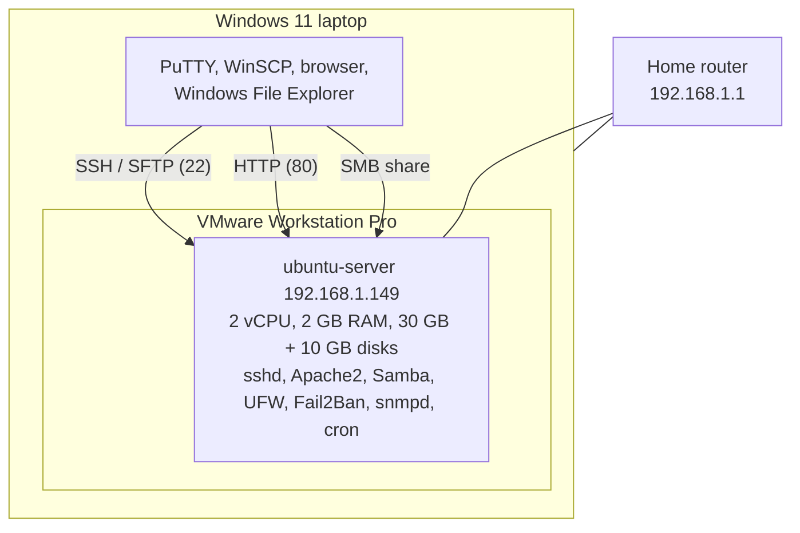

# Ubuntu Server Home Lab.

A step-by-step build of an Ubuntu Server 24.04.2 LTS virtual machine on a Windows 11 laptop with VMware Workstation Pro. It covers installation, remote access, networking, users and permissions, storage, file sharing, a web server, scripting, firewall and SSH hardening, monitoring, SNMP and scheduled automation.


## Contents

- Overview
- Objectives
- Technologies Used
- Skills Demonstrated
- Environment
- Lab Architecture
- Project Scope
- Repository Structure
- Implementation Summary
- Configuration Reference
- Validation and Testing
- Troubleshooting
- Security Considerations
- Lessons Learned
- Future Improvements
- Author

## Overview

I learn best by building things, so I set out to build a Linux server from scratch and document it as I went. The build log was written in the order I did the work, and for each task it records what I did, why I did it and how I knew it worked.

The hardware is an ordinary laptop, not a rack server. The point was to design the VM around the resources I actually have: 2 vCPUs, 2 GB of RAM and a 30 GB disk, leaving the rest for Windows.


A PuTTY session to the Ubuntu server showing the login banner and a shell prompt for the `klint` account.


## Objectives

- Install Ubuntu Server from a verified ISO and size the VM for an 8 GB host.
- Manage the server remotely over SSH and give it a static IP with Netplan.
- Practise user, group, sudo, permission and file system administration.
- Add and permanently mount a second virtual disk.
- Share files with Windows using WinSCP and Samba, and host a test website with Apache.
- Write first Python and Bash scripts and schedule a job with cron.
- Harden the server with UFW, SSH settings, key authentication and Fail2Ban.
- Monitor CPU, disk, disk I/O, network and services, and enable an SNMP agent.

## Technologies Used

| Area | Technology |
| --- | --- |
| Host | Windows 11, Intel Core i5 (4 cores), 8 GB RAM, 256 GB SSD |
| Hypervisor | VMware Workstation Pro (free for personal use) |
| Guest OS | Ubuntu Server 24.04.2 LTS |
| Remote access | OpenSSH, PuTTY, WinSCP |
| Networking | Netplan (YAML), `ip`, `ping` |
| File sharing | Samba, SFTP |
| Web | Apache2 |
| Scripting | Python 3, pip, Bash, cron |
| Security | UFW, OpenSSH hardening, SSH keys, Fail2Ban, unattended-upgrades, AppArmor |
| Monitoring | htop, df, du, ncdu, iostat, iotop, vmstat, ifstat, nload, iftop, ss, ethtool, SNMP (snmpd) |

## Skills Demonstrated

| Skill | Where it appears |
| --- | --- |
| VM sizing and Linux installation | VM and installation |
| SSH, static networking | Remote access and networking |
| Users, groups, sudo, updates | System and user administration |
| Disk partitioning, fstab, permissions | Storage and file system |
| Samba, Apache, Python | File sharing and services |
| Bash scripting, cron | Scripting and automation |
| Firewall and SSH hardening, Fail2Ban | Security hardening |
| Performance monitoring, SNMP | Monitoring |
| Troubleshooting method | Troubleshooting |

## Environment

| Item | Detail |
| --- | --- |
| Host | Windows 11, Intel Core i5 (4 cores), 8 GB RAM, 256 GB SSD |
| Hypervisor | VMware Workstation Pro |
| VM name | `ubuntu-server` |
| Guest OS | Ubuntu Server 24.04.2 LTS, Live Server ISO, no desktop |
| vCPU / RAM | 1 processor, 2 cores / 2 GB (2048 MB) |
| Disks | 30 GB system disk (LVM) and a 10 GB second disk (`/dev/sdb`) |
| Network | Bridged adapter, static address `192.168.1.149/24`, gateway `192.168.1.1`, interface `ens33` |
| Admin account | `klint` (with `sudo`) |

## Lab Architecture



The VM uses a bridged adapter, so it appears on the home network as its own device with its own address.

## Project Scope

**In scope:** everything listed in Objectives.

**Not covered in the documentation**

- Public exposure of any service to the internet
- Domain names, TLS certificates or HTTPS configuration for Apache
- Databases, containers or a reverse proxy
- A monitoring server polling the SNMP agent (the agent is configured and tested locally)
- Two-factor authentication for SSH beyond installing the module and generating a secret (treated as optional)

## Repository Structure

```
.
├── README.md
├── LICENSE
├── .gitignore
├── configs/
│   ├── 50-cloud-init.yaml.netplan   Static IP configuration
│   ├── sshd_config-changes.txt      SSH hardening settings
│   ├── jail.local-sshd.txt          Fail2Ban SSH jail settings
│   ├── smb.conf-share.txt           Samba share definition
│   ├── snmpd.conf-changes.txt       SNMP agent settings
│   ├── fstab-entry.txt              Permanent mount for the second disk
│   ├── ufw-rules.txt                Firewall rules applied
│   └── crontab-entry.txt            Scheduled backup job
├── scripts/
│   ├── hello.py                     First Python script
│   ├── welcome.sh                   First Bash script
│   └── index.html                   Custom Apache test page
├── docs/
│   ├── 01-vm-and-installation.md
│   ├── 02-remote-access-and-networking.md
│   ├── 03-system-and-user-administration.md
│   ├── 04-storage-and-file-system.md
│   ├── 05-file-sharing-and-services.md
│   ├── 06-scripting-and-automation.md
│   ├── 07-security-hardening.md
│   ├── 08-monitoring.md
│   ├── troubleshooting.md
│   ├── command-reference.md
│   └── lessons-learned.md
└── screenshots/
    └── README.md                    Index of expected screenshots
```

## Implementation Summary

| Guide | Chapters | Outcome |
| --- | --- | --- |
| VM and installation | 1 to 3 | Verified ISO, right-sized VM, Ubuntu installed with OpenSSH |
| Remote access and networking | 4 to 5 | PuTTY over SSH, static IP with Netplan |
| System and user administration | 6 to 10 | Update routine, users, groups, sudo, nano and vim |
| Storage and file system | 11 to 14 | Second disk mounted permanently, file management, permissions |
| File sharing and services | 15 to 19 | WinSCP, Samba, APT, Apache page, Python and pip |
| Scripting and automation | 20, 21, 33 | Python and Bash scripts, cron backup job |
| Security hardening | 22 to 26 | UFW, SSH hardening, keys, Fail2Ban, updates, AppArmor |
| Monitoring | 27 to 32 | CPU, services, disk, I/O, network tools, SNMP |

Configuration files are in `configs/` and scripts in `scripts/`.

## Configuration Reference

| Area | Setting |
| --- | --- |
| ISO | `ubuntu-24.04.2-live-server-amd64.iso`, SHA256 checked with `Get-FileHash` |
| Install | Entire disk with default LVM layout, OpenSSH server selected, no featured snaps |
| Static IP | `192.168.1.149/24`, default route `192.168.1.1`, DNS `1.1.1.1` and `8.8.8.8` |
| Second disk | 10 GB, `/dev/sdb1`, ext4, mounted at `/mnt/data` through an `/etc/fstab` UUID entry |
| Samba | `[share]` at `/mnt/data/share`, browsable, writable, guest access (lab only) |
| Apache | Default page replaced with `/var/www/html/index.html` |
| UFW | Allow OpenSSH and Apache Full, then enable; SNMP allowed from `192.168.1.0/24` |
| SSH | `PermitRootLogin no`, key authentication, `PasswordAuthentication no`, default port kept |
| Fail2Ban | `maxretry = 5`, `findtime = 600`, `bantime = 36000` for `sshd` |
| SNMP | Read-only community, restricted view, agent bound to `192.168.1.149:161` |
| Cron | `0 3 * * *` runs `/home/klint/backup.sh`, output appended to `/var/log/backup.log` |

## Validation and Testing

| Area | Test | Result |
| --- | --- | --- |
| ISO integrity | `Get-FileHash` against Ubuntu’s published SHA256 | Values matched |
| Static IP | `ping 8.8.8.8`, then `ping google.com` | Both worked, showing connectivity and DNS |
| File transfer | WinSCP upload and download, checked with `ls -l` | Files transferred both ways |
| Samba | File created from Windows seen on Ubuntu, and the reverse | Both directions worked |
| Apache | Custom page opened from a Windows browser | Page displayed |
| fstab | Reboot, then `df -h` | Second disk mounted automatically |
| SSH keys | New session before disabling passwords | Logged in with the key, no password prompt |
| Fail2Ban | `fail2ban-client status sshd` after restart | SSH jail checked |
| SNMP | `snmpwalk` against the agent | Command documented; output not recorded |

See each guide for details. Items without recorded output are marked as such.

## Troubleshooting

Troubleshooting gathers the diagnostic checks from the lab: SSH will not connect, Netplan changes lock me out, Apache page does not load, SNMP times out and a cron job does not run, plus the layered approach I use.

## Security Considerations

- **Least privilege:** a normal account with `sudo` rather than working as root; root login over SSH disabled.
- **Authentication:** SSH key login tested before passwords were disabled, with the VMware console kept as a recovery path.
- **Exposure:** UFW allows only what the server needs; SNMP is limited to the LAN and bound to the server address.
- **Automatic response:** Fail2Ban blocks an address after five failed logins within ten minutes for about ten hours.
- **Maintenance:** automatic security updates, AppArmor, and a review of listening ports and enabled services.
- **Known lab compromise:** the Samba share allows guest access. That is acceptable on an isolated home network and would not be acceptable in production. See Security hardening.
- **Repository hygiene:** no private keys, passwords or real SNMP community strings are stored here.

## Lessons Learned

- Size the VM to the workload and the host, not to the maximum.
- Keep a second way into the server before changing SSH or network settings.
- Test each part separately: IP connectivity before DNS, local service before remote access.
- “It works” is not the same as “it is secure”, as with the guest Samba share.
- Security is layered; no single setting does it.

More in Lessons learned.

## Future Improvements

- Docker containers, a database server and an Nginx reverse proxy.
- Centralised logging and SIEM integration.
- A monitoring server (PRTG, Zabbix or Nagios) polling the SNMP agent.
- Authenticated Samba users instead of guest access.
- Infrastructure automation with Ansible.
- Complete the optional SSH two-factor authentication.
